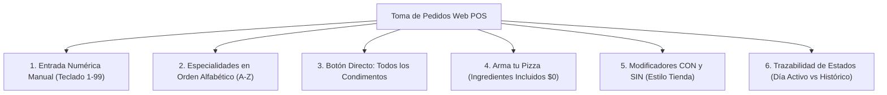

# Guía Operativa: Novedades en el Sistema de Toma de Pedidos Web POS
**Pizza Americana — Actualización Operativa y Técnica**  
*Fecha: Noviembre 2026 | Versión: 2.1 (Alineación con Tiendas)*

---

## 1. Propósito de esta Actualización

Para garantizar que el nuevo sistema web de toma de pedidos (**`TomaPedidosPOS.html`**) funcione con la misma agilidad, lógica y reglas que las pantallas táctiles de las tiendas físicas, se realizaron seis (6) mejoras operativas directas basadas en las pruebas de los asesores.

Este documento explica cómo funciona cada mejora tanto a nivel de **operación del asesor** como a nivel de **comportamiento del sistema**.

---

## 2. Detalle de las Novedades Implementadas



---

### Novedad 1: Consulta de Estados en Tienda (Día Activo vs. Histórico)

> [!NOTE]
> **¿Qué ocurría?**  
> Cuando un asesor consultaba un pedido tomado el día anterior en la pantalla de *Estados Pedidos Tienda*, el sistema indicaba que no había registros coincidentes, a pesar de que el pedido había llegado e impreso correctamente en la tienda.

* **Explicación para el personal:**  
  La pantalla **`Estados Pedidos Tienda`** funciona como un **radar en vivo del día contable activo**. Al finalizar la jornada, las tiendas ejecutan su proceso de cierre diario (*Close of Day*). Una vez cerrada la jornada, los pedidos del día anterior pasan al archivo histórico.
* **Dónde consultarlo:**  
  * **Pedidos del día en curso (en preparación / despacho):** Pantalla *Estados Pedidos Tienda*.
  * **Pedidos de días anteriores:** Pantalla **`EstadosHistorialPedido.html`** (o seleccionando el filtro de fechas en el historial central).

---

### Novedad 2: Botón "Todos los Condimentos" en Menú

* **Cómo operaba antes:**  
  El asesor debía seleccionar salsa de tomate, orégano, ají y servilletas uno por uno, aumentando el tiempo de atención telefónica o por WhatsApp.
* **Cómo opera ahora:**  
  * En la categoría **`Condimentos Otros`**, ahora aparece directamente la tarjeta **"Todos los Condimentos"** ($0).
  * El sistema ya cuenta con el producto homologado (`idproducto = 554`) en las **13 tiendas de la cadena**.
  * Al hacer un solo clic, se envía la instrucción completa a la comanda de la tienda.

---

### Novedad 3: Especialidades e Ingredientes en Orden Alfabético (A - Z)

* **Beneficio operativo:**  
  Antes los sabores aparecían según el orden de creación interna en la base de datos, lo que obligaba al asesor a buscar visualmente en toda la cuadrícula.
* **Comportamiento actual:**  
  * Todas las especialidades (Americana, BBQ, Carnes, Criolla, Hawaiana, Pollo Champiñón, etc.) y los ingredientes se listan en **estricto orden alfabético**.
  * Aplica tanto para la pizza completa (100%) como para las columnas de Mitad 1 y Mitad 2.

---

### Novedad 4: Entrada Numérica Manual en Cantidades (Vasos, Porcioneros, etc.)

> [!TIP]
> **Aceleración en pedidos grandes:**  
> Si un cliente solicita 15 porcioneros de salsa o 20 vasos, el asesor ya no tiene que hacer 20 clics repetitivos en el botón `+`.

* **Cómo usarlo:**  
  * El asesor hace clic en la casilla de cantidad.
  * Digita el número con el teclado numérico (ejemplo: `15`, `25`, `50`).
  * El sistema valida automáticamente un rango seguro de **1 a 99 unidades**.
  * Si prefiere, puede seguir utilizando los botones `+` y `-` para ajustes rápidos.

---

### Novedad 5: "Arma tu Pizza" con Ingredientes Incluidos ($0)

* **Flujo en Tienda replicado en Web:**  
  En las tiendas, cuando un cliente pide "Arma tu Pizza", el sistema exige seleccionar hasta **3 ingredientes incluidos** en el precio base.
* **Cómo opera ahora en el Contact Center:**  
  1. Al seleccionar la especialidad **"Arma tu Pizza"** (en tamaño XL, Grande, Mediana o Personal), se abre automáticamente el panel amarillo:  
     `🍕 Ingredientes Arma tu Pizza: 0/3 (Elige hasta 3 incluidos)`.
  2. El asesor hace clic en los ingredientes que el cliente elija (ej: *Tocineta*, *Maíz*, *Champiñón*).
  3. Los ingredientes seleccionados se marcan en verde y **no suman costo extra ($0)**.
  4. Si el pedido es Mitad y Mitad y el asesor presiona el botón **`Toda la Pizza`**, los ingredientes elegidos en la Mitad 1 se copian automáticamente a la Mitad 2.
  5. El sistema no permite agregar la pizza a la comanda sin haber elegido al menos un ingrediente.

---

### Novedad 6: Modificadores "PRODUCTO CON" y "PRODUCTO SIN" (Estilo Tienda)

Para atender requerimientos especiales de cocina (clientes alérgicos o preferencias de preparación) sin recurrir a notas manuales propensas a errores:

````carousel
```markdown
<!-- slide -->
### 1. Panel de Modificadores en el Modal de Pizza
Debajo de la selección de sabor aparecen los botones:
• [ 👍 PRODUCTO CON ]: Abre ingredientes adicionales disponibles.
• [ 👎 PRODUCTO SIN ]: Abre los ingredientes de la receta para retirar.
```
<!-- slide -->
```markdown
### 2. Ejemplo de Selección "PRODUCTO SIN"
El cliente pide Pizza Hawaiana pero no desea cebolla:
• Clic en [ 👎 PRODUCTO SIN ]
• Clic en el botón "SIN Cebolla" ($0)
• El botón se resalta en rojo con check.
```
<!-- slide -->
```markdown
### 3. Visualización en la Comanda y Despacho a Tienda
En la comanda lateral y en la comanda de cocina de la tienda se imprime:
• Pizza Hawaiana XL
  └─ [ 👎 SIN ] Cebolla ($0)
  └─ [ 👍 CON ] Extra Queso (+$5.000)
```
````

* **Integración con la tienda:**  
  Estos modificadores no viajan como texto plano suelto; viajan con su identificador técnico (`idmodificador`), imprimiéndose en la comanda de cocina de la tienda en el formato oficial de PixelPOS.

---

## 3. Resumen Rápido para Capacitación de Asesores

| Situación del Cliente | Acción del Asesor en el Nuevo POS | Resultado en Comanda / Tienda |
| :--- | :--- | :--- |
| **"Quiero todos los condimentos"** | Clic en submenú *Condimentos* -> Tarjeta *Todos los Condimentos*. | Sale como 1 ítem a $0 directo a tienda. |
| **"Deseo 12 porcioneros de ajo"** | Clic en *Porcionero Ajo* -> Escribir `12` en el campo cantidad con el teclado. | Carga 12 unidades sin dar 12 clics. |
| **"Quiero Arma tu Pizza XL"** | Seleccionar *Arma tu Pizza XL* -> Seleccionar hasta 3 ingredientes del panel interactivo. | Se incluyen a $0 y viajan a cocina. |
| **"Una pizza pero sin cebolla"** | Seleccionar sabor -> Clic en `[ 👎 PRODUCTO SIN ]` -> Seleccionar ingrediente. | Se añade badge rojo `SIN` a la comanda. |
| **"Quiero saber el estado de un pedido de ayer"** | Abrir la pantalla de *Historial de Pedidos*, no la de monitoreo activo del día. | Muestra el estado final cerrado. |

---

> [!IMPORTANT]
> **Versión Desplegada:**  
> Estos cambios se encuentran integrados en la rama **`JuanDavidClaude`** y están activos en la versión web para pruebas y operación.
