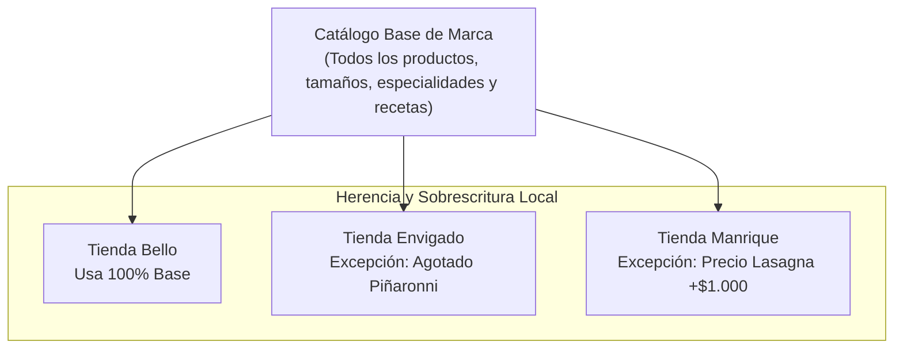

# 🍕 Skill 01: Catálogo y Menú (Modelo POS como Fuente de Verdad)

## 1. Diagnóstico del Problema en Gloria Food
En la arquitectura anterior de Gloria Food existían graves ineficiencias:
1. **Configuración manual multiplicada:** Existían **11 menús separados** (uno por tienda). Cualquier cambio de precio o producto nuevo requería replicarse 11 veces a mano `[Capturas]`.
2. **Duplicación por tamaño:** Debido a que Gloria Food no maneja herencia ni recargos dinámicos por porción, se crearon grupos de opciones redundantes con sufijos en texto (`Elige uno o dos sabor de tu pizza PZ`, `... MD`, `... GD`, `... XL`) `[Verificado en logs]`.
3. **Desconexión con el POS:** Los SKUs de Gloria Food requerían tablas de homologación complejas (`homologacion_producto_pedidovirtual`) para traducirse a los códigos internos de la tienda.

---

## 2. La Fuente de Verdad: Modelo del POS de Tienda (`tiendaamericana`)
El POS propio (`tienda.pos = 1`, base MySQL `tiendaamericana`) es el estándar más robusto y completo del negocio `[Verificado en tienda Bello 192.168.2.20]`.

### 2.1 Clasificación por `tipo_producto`
En la tabla `producto` del POS, los ítems se categorizan mediante la columna `tipo_producto`:

| `tipo_producto` | Significado | Ejemplos en BD | Rol en el Menú |
|---|---|---|---|
| **`P`** | **Pizza Padre (Tamaño)** | `Pizza PZ`, `Pizza MD`, `Pizza GD`, `Pizza XL` | Define el tamaño, número de porciones y el **precio base** (`precio1`). |
| **`D`** | **Especialidad (Sabor)** | `Hawaiana GD`, `Americana GD`, `Peperoni y Queso GD`, `Piñaronni GD` | Define el sabor de la pizza. Posee el **recargo** en `precio10`. |
| **`A`** | **Adición** | `Adición Maiz XL`, `Adición Piña XL`, `Adición Tocineta MD` | Ingredientes extras que se cobran adicionalmente. |
| **`O`** | **Otros Productos** | `Alitas BBQ`, `Lasagna Mixta`, `Deditos Americanos`, `Nuggets` | Productos de carta general independientes. |
| **`MC`** | **Modificador CON** | `Con Jamón XG`, `Con Piña XG`, `Con Tocineta MD` | Instrucción de agregar ingrediente a una especialidad. |
| **`MS`** | **Modificador SIN** | `Sin Jamón XG`, `Sin Piña XG`, `Sin Cebolla MD` | Instrucción de retirar ingrediente de la especialidad. |

---

## 3. Lógica de Especialidades, Mitad y Mitad y Recargos

```mermaid
graph TD
    PizzaP["Pizza Padre: Pizza GD (Tipo P)<br/>Base: $48.000 (precio1)"]
    Pregunta["Pregunta Obligatoria: idpregunta = 2<br/>'Pizza Grande' (obliga_eleccion=1, permite_dividir=2)"]
    
    PizzaP -->|idpreguntaforzada1| Pregunta
    
    Pregunta -->|Elección 1| Sabor1["Especialidad 1: Peperoni y Queso GD (Tipo D)<br/>precio10 = $3.500"]
    Pregunta -->|Elección 2 (Mitad y Mitad)| Sabor2["Especialidad 2: Hawaiana Artesanal GD (Tipo D)<br/>precio10 = $0"]
    
    Sabor1 --> Recargo1["Recargo Mitad 1: $3.500 / 2 = +$1.750"]
    Sabor2 --> Recargo2["Recargo Mitad 2: $0 / 2 = +$0"]
    
    PizzaP --> Total["Total Ítem: $48.000 + $1.750 + $0 = $49.750"]
    Recargo1 --> Total
    Recargo2 --> Total
```

### 3.1 Esquema de la Tabla `pregunta`
* `idpregunta`: Identificador (ej. `2` para GD, `4` para XL, `5` para MD, `6` para PZ).
* `obliga_eleccion`: `1` (Obligatorio seleccionar al menos un sabor).
* `permite_dividir`: **`2`** -> **Indica que permite Mitad y Mitad**.
* `numero_minimo_eleccion`: `0` o `1`.
* `numero_maximo_eleccion`: `1` (pizza completa de 1 sabor) o `2` (mitad y mitad).

### 3.2 Tabla `eleccion_forzada`
Relaciona la pregunta del tamaño con los sabores disponibles:
* `ideleccion_forzada`: ID autonumérico.
* `idpregunta`: ID de la pregunta (ej. `2`).
* `idproducto`: ID del producto sabor (tipo `D`, ej. `347` para `Peperoni y Queso GD`).
* `precio`: **`precio10`** -> Indica la columna de la tabla `producto` de donde se extrae el recargo.

### 3.3 Regla Matemática de Recargo por Especialidad
$$\text{Recargo Ítem} = \begin{cases} 
\text{precio10} & \text{si es pizza de 1 solo sabor} \\
\frac{\text{precio10}_{mitad1}}{2} + \frac{\text{precio10}_{mitad2}}{2} & \text{si es Mitad y Mitad} 
\end{cases}$$

*Ejemplo verificado en BD Bello:*
* `Pizza GD` (`idproducto: 7`): `precio1` = $48.000.
* Mitad 1 `Peperoni y Queso GD` (`idproducto: 347`): `precio10` = $3.500 -> Recargo = $1.750.
* Mitad 2 `Hawaiana Artesanal GD` (`idproducto: 586`): `precio10` = $0 -> Recargo = $0.
* **Total Pizza:** $\$48.000 + \$1.750 + \$0 = \$49.750$. *(Coincide exactamente con el desglose visto en los pedidos de Gloria Food)*.

---

## 4. Modificadores "CON" y "SIN"

En el POS cada especialidad tiene parametrizados sus modificadores en dos tablas dedicadas:
1. **`producto_modificador_con` (`idproducto`, `idproductocon`):**
   * Asocia una especialidad con sus ingredientes "CON" (tipo `MC`).
   * Ejemplo: `Hawaiana XL` (`303`) -> `Con Tocineta XG` (`165`), `Con Jamón XG` (`100`).
2. **`producto_modificador_sin` (`idproducto`, `idproductosin`):**
   * Asocia una especialidad con sus ingredientes "SIN" (tipo `MS`).
   * Ejemplo: `Hawaiana XL` (`303`) -> `Sin Jamón XG` (`175`), `Sin Piña XG` (`176`), `Sin Queso XG` (`194`).

> [!TIP]
> **Mejora para la Tienda Nueva:** En la interfaz de usuario, no es necesario listar los productos `MC` o `MS` como productos aislados. Al seleccionar una especialidad, el front-end simplemente consulta los modificadores asociados y muestra switches interactivos: **[+ Agregar]** o **[- Quitar]** por ingrediente base.

---

## 5. Combos y Productos Incluidos (`producto_incluido`)
Para promociones como combos insuperables o deditos:
* Tabla `producto_incluido` (`idproductoincluido`, `idproductoincluye`, `cantidad`, `precio`).
* Ejemplo verificado:
  * `Deditos Americanos` (`idproducto: 4`) incluye automáticamente `Arequipe` (`248`, cantidad `1.0`) o `Chocolate` (`454`, cantidad `1.0`).
  * `Combo 2 Medianas` (`idproducto: 422` y `423`): permite seleccionar 2 pizzas medianas con sus respectivas especialidades.

---

## 6. Arquitectura de Menú de Marca con Herencia por Tienda

Para cumplir la exigencia de **no mantener 11 menús separados**, la tienda virtual implementará el patrón **Base + Excepciones**:



### 6.1 Estructura Recomendada de Tablas de Excepción

```sql
-- Excepciones de catálogo por tienda
CREATE TABLE IF NOT EXISTS tienda_producto_excepcion (
    idtienda INT NOT NULL,
    idproducto INT NOT NULL,
    disponible CHAR(1) DEFAULT 'S', -- 'S': Disponible, 'N': Bloqueado en esta tienda
    precio_sobrescrito DECIMAL(10,2) NULL, -- NULL hereda precio base de marca
    habilitado_canal_virtual CHAR(1) DEFAULT 'S',
    motivo VARCHAR(200) NULL,
    fechamodificacion TIMESTAMP DEFAULT CURRENT_TIMESTAMP ON UPDATE CURRENT_TIMESTAMP,
    PRIMARY KEY (idtienda, idproducto)
);
```

---

## 7. Contrato JSON Recomendado para el Front-end (API Menú)

```json
{
  "categoria": "Pizzas Tradicionales",
  "idproducto": 7,
  "nombre": "Pizza Grande (8 porciones)",
  "tamano": "GD",
  "precio_base": 48000,
  "permite_mitad_mitad": true,
  "especialidades": [
    {
      "idespecialidad": 330,
      "nombre": "Hawaiana",
      "recargo_completa": 0,
      "recargo_mitad": 0,
      "ingredientes_sin": [
        {"id": 175, "nombre": "Jamón"},
        {"id": 176, "nombre": "Piña"},
        {"id": 194, "nombre": "Queso"}
      ],
      "ingredientes_con": [
        {"id": 165, "nombre": "Tocineta"}
      ]
    },
    {
      "idespecialidad": 347,
      "nombre": "Peperoni y Queso",
      "recargo_completa": 3500,
      "recargo_mitad": 1750,
      "ingredientes_sin": [
        {"id": 214, "nombre": "Pepperoni"},
        {"id": 194, "nombre": "Queso"}
      ],
      "ingredientes_con": []
    }
  ],
  "adiciones_disponibles": [
    {"id": 10, "nombre": "Maíz Tierno", "precio": 6000},
    {"id": 19, "nombre": "Tocineta", "precio": 7000}
  ]
}
```
