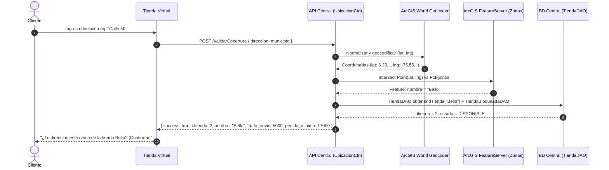
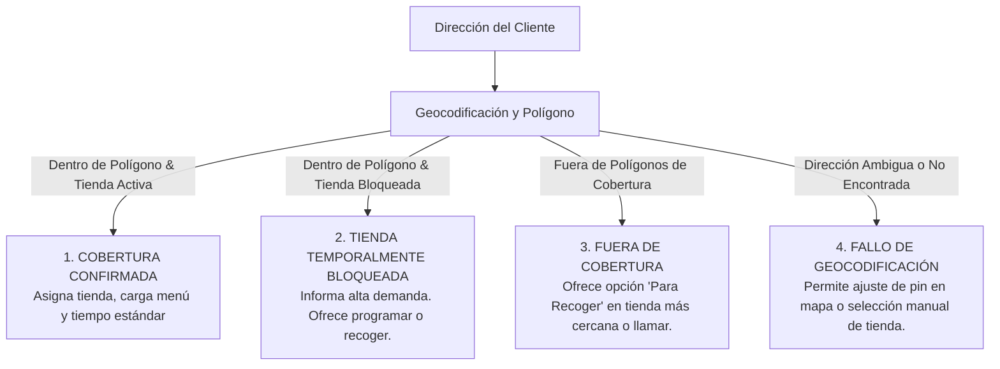

# 📍 Skill 02: Cobertura, Zonas y Domicilio

## 1. El Nuevo Flujo de Entrada Única
En la solución anterior, WordPress presentaba un selector con **11 botones** (uno por tienda), lo cual generaba fricción y confusión en los clientes `[Verificado]`.

### El Requerimiento Clave:
* **Un único punto de entrada digital.**
* El usuario ingresa su dirección (o pin en el mapa / geolocalización del navegador).
* El sistema normaliza la dirección, consulta los polígonos de cobertura y deduce la tienda asignada.
* Se presenta un diálogo de confirmación: *"Tu dirección se encuentra dentro de la cobertura de la tienda: **Bello**. ¿Es correcto?"* `[Capturas]`.
* Si el cliente lo desea, se ofrece un **selector manual de respaldo**.

---

## 2. Motor de Geocodificación y Polígonos (ArcGIS)

La lógica de zonificación está centralizada en `capaControladorCC.UbicacionCtrl.java` `[Verificado]`:



### 2.1 Endpoints de ArcGIS en Uso `[Verificado en código]`:
1. **Geocodificador:**
   `https://geocode-api.arcgis.com/arcgis/rest/services/World/GeocodeServer`
2. **FeatureServer de Polígonos:**
   `https://services1.arcgis.com/PezsEKOq8AU6Mcbj/arcgis/rest/services/zonas/FeatureServer/0`
   * Los atributos de los polígonos devuelven el campo `nombre` con el nombre exacto de la tienda (ej. `"Bello"`, `"Manrique"`, `"Envigado"`).

---

## 3. Tarifas de Domicilio y Pedido Mínimo `[Capturas y BD]`

Las capturas de configuración de Gloria Food y la tabla `producto` de la base central ratifican la política comercial unificada:

| Concepto | Valor Oficial | Referencia en BD / Capturas | Regla de Negocio |
|---|---|---|---|
| **Costo de Envío** | **$5.000 COP** | Producto ID `246` en `producto` (`Domicilio PA ($5.000)`) | Tarifa plana por polígono de tienda. No se cobra por kilómetro ni por distancia variable. |
| **Pedido Mínimo** | **$17.000 COP** | Capturas de Gloria Food (`Monto mínimo: 17000 COP`) | El total de productos (sin contar el envío) debe ser $\ge \$17.000$. |
| **Envío Gratis (Promo)** | **$0 COP** | Producto ID `247` (`Domicilio ($0)`) | Se aplica si el usuario redime cupones promocionales (ej. `DOMIGRATIS`). |

### 3.1 Validación en Checkout
```javascript
// Validación obligatoria en cliente y servidor
function validarPedidoMinimo(totalProductos) {
    const PEDIDO_MINIMO = 17000;
    if (totalProductos < PEDIDO_MINIMO) {
        const faltante = PEDIDO_MINIMO - totalProductos;
        return {
            valido: false,
            mensaje: `El pedido mínimo para domicilio es de $${PEDIDO_MINIMO.toLocaleString('es-CO')}. Te faltan $${faltante.toLocaleString('es-CO')}.`
        };
    }
    return { valido: true };
}
```

---

## 4. Matriz de Estados de Cobertura y Contingencias

Al evaluar la dirección ingresada pueden presentarse cuatro escenarios:



### 4.1 Tratamiento de Direcciones:
* En el flujo actual de Kuno, la dirección del cliente no se normalizaba al insertar en el central (`idnomenclatura = 1` y `idmunicipio = 1` fijos).
* **Mejora para la nueva tienda:** Guardar la dirección estructurada (`direccion_texto`, `latitud`, `longitud`, `barrio`, `municipio`, `indicaciones_entrega` como apto/torre).

---

## 5. Contrato JSON API Cobertura (Propuesta Estandarizada)

### Request (`POST /api/v1/cobertura/validar`)
```json
{
  "direccion": "Carrera 48 # 65-10",
  "municipio": "Bello",
  "barrio": "Niquia",
  "coordenadas": {
    "lat": 6.3385,
    "lng": -75.5521
  }
}
```

### Response Success (`200 OK`)
```json
{
  "cobertura": true,
  "tienda": {
    "idtienda": 13,
    "nombre": "Niquia",
    "estado": "DISPONIBLE",
    "tiempo_estimado_minutos": 45,
    "permite_domicilio": true,
    "permite_recoger": true
  },
  "tarifas": {
    "costo_domicilio": 5000,
    "pedido_minimo": 17000
  },
  "direccion_normalizada": "Carrera 48 # 65-10, Bello, Antioquia"
}
```
