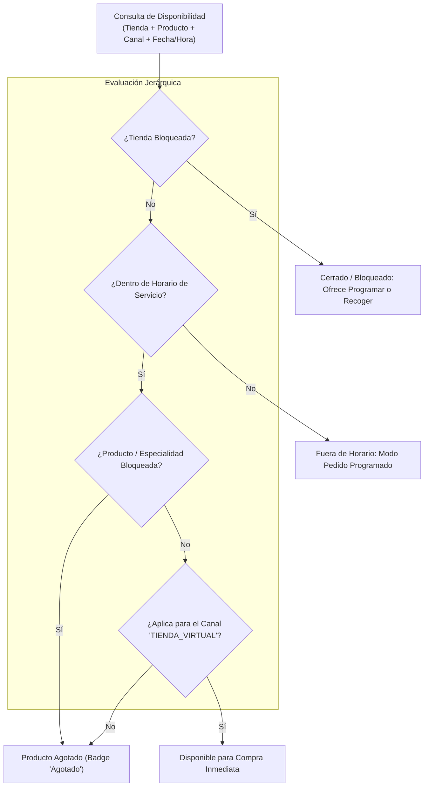

# ⏱️ Skill 03: Disponibilidad, Horarios y Bloqueos

## 1. Diagnóstico del Estado Actual y Vulnerabilidades
1. **Desconexión Central - Gloria Food:** Cuando una tienda o producto se bloqueaba en el central (`tienda_bloqueada`, `producto_no_existente`), **no llegaba a Gloria Food**. La administradora debía ingresar a Gloria Food y repetir el bloqueo manualmente `[Verificado en código y BD]`.
2. **Inexistencia de bloqueos por canal:** No era posible desactivar un producto únicamente para la tienda virtual manteniendo la venta en contact center o mesa.
3. **Validación exclusiva en frontend:** Las reglas de horarios de promociones (`excepcion_precio`) se evaluaban en el navegador (`pedidos.js`), sin verificación estricta en el servlet central `[Verificado]`.
4. **Falta de desbloqueo programado:** El campo `desbloqueo_en` era meramente informativo (texto) y no reactivaba automáticamente la tienda `[Verificado]`.

---

## 2. Reglas de Horarios de Servicio y Desfase de Domicilios `[Capturas]`

Las capturas de configuración de Kuno ratifican que el servicio a domicilio tiene un **desfase de 30 minutos** respecto a la apertura del restaurante para permitir el alistamiento de hornos y cocina:

| Día | Horario Restaurante (Cocina / Salón) | Horario Servicio a Domicilio |
|---|---|---|
| **Lunes a Jueves** | 04:00 PM – 09:30 PM | **04:30 PM – 09:30 PM** |
| **Viernes** | 04:00 PM – 10:30 PM | **04:30 PM – 10:30 PM** |
| **Sábado** | 12:00 PM – 10:30 PM | **12:30 PM – 10:30 PM** |
| **Domingo** | 12:00 PM – 09:30 PM | **12:30 PM – 09:30 PM** |

### 2.1 Excepciones por Fecha Específica
El sistema debe soportar sobrescrituras para días festivos, mantenimientos o emergencias climáticas (ejemplo visto en captura: `24 Oct 2026: 12:00 PM - 07:26 PM`).

---

## 3. Matriz del Nuevo Motor de Disponibilidad

El nuevo módulo debe evaluar la disponibilidad de forma multidimensional antes de presentar el catálogo y antes de confirmar un pago:



---

## 4. Esquema de Base de Datos para el Nuevo Módulo

Se unifican los bloqueos de tiendas y productos bajo un modelo transaccional y auditable:

```sql
-- 1. Horarios de servicio por tienda (con desfase para delivery)
CREATE TABLE IF NOT EXISTS tienda_horario (
    idtienda INT NOT NULL,
    dia_semana TINYINT NOT NULL, -- 1=Lunes, 7=Domingo
    hora_apertura_restaurante TIME NOT NULL,
    hora_cierre_restaurante TIME NOT NULL,
    hora_apertura_domicilio TIME NOT NULL,
    hora_cierre_domicilio TIME NOT NULL,
    PRIMARY KEY (idtienda, dia_semana)
);

-- 2. Excepciones puntuales de horario
CREATE TABLE IF NOT EXISTS tienda_horario_excepcion (
    idexcepcion INT AUTO_INCREMENT PRIMARY KEY,
    idtienda INT NOT NULL,
    fecha DATE NOT NULL,
    cerrado_todo_el_dia CHAR(1) DEFAULT 'N',
    hora_apertura_domicilio TIME NULL,
    hora_cierre_domicilio TIME NULL,
    motivo VARCHAR(200)
);

-- 3. Motor central de bloqueos unificado
CREATE TABLE IF NOT EXISTS disponibilidad_bloqueo (
    idbloqueo INT AUTO_INCREMENT PRIMARY KEY,
    idtienda INT NULL, -- NULL = Aplica a TODAS las tiendas
    idproducto INT NULL, -- NULL = Aplica a TODA la tienda
    idespecialidad INT NULL,
    canal ENUM('TODOS', 'TIENDA_VIRTUAL', 'CALL_CENTER', 'BOT', 'PLATAFORMAS') DEFAULT 'TODOS',
    tipo_bloqueo ENUM('INDEFINIDO', 'PROGRAMADO') DEFAULT 'INDEFINIDO',
    fecha_inicio DATETIME NOT NULL DEFAULT CURRENT_TIMESTAMP,
    fecha_fin DATETIME NULL, -- Desbloqueo automático al llegar a fecha_fin
    activo TINYINT(1) DEFAULT 1,
    motivo VARCHAR(255) NOT NULL,
    usuario_creacion VARCHAR(50) NOT NULL,
    aprobado TINYINT(1) DEFAULT 1,
    INDEX idx_disp (idtienda, idproducto, canal, activo)
);
```

---

## 5. Estrategia de Manejo de Demanda (Tiempos vs. Bloqueos)

> [!IMPORTANT]
> **Mejor Práctica Comercial:** En momentos de alta demanda (lluvia torrencial, congestión de hornos), **bloquear la tienda es el último recurso**. 
> La plataforma debe permitir al administrador aumentar temporalmente el `tiempo_pedido_tienda` (ej. de 45 a 90 minutos). El front-end advertirá al cliente: *"Tiempo de entrega estimado: 80 - 90 min por alta demanda en cocina"*. El cliente decide si espera, evitando la pérdida directa de la venta.

---

## 6. Validación Obligatoria en Servidor (Anti-Fraude y Consistencia)

```java
// Pseudocódigo del validador que debe ejecutarse en el endpoint de Checkout
public void validarDisponibilidadPedido(PedidoRequest pedido) throws DisponibilidadException {
    int idTienda = pedido.getIdTienda();
    
    // 1. Validar estado general de la tienda
    if (DisponibilidadDAO.isTiendaBloqueada(idTienda, "TIENDA_VIRTUAL")) {
        throw new DisponibilidadException("La tienda seleccionada no se encuentra recibiendo pedidos digitales en este momento.");
    }
    
    // 2. Si no es programado, validar horario en vivo
    if (!pedido.isProgramado()) {
        if (!DisponibilidadDAO.isDentroDeHorarioDomicilio(idTienda, LocalTime.now())) {
            throw new DisponibilidadException("La tienda ha cerrado su servicio a domicilio. Puedes programar tu pedido para más tarde.");
        }
    }
    
    // 3. Validar disponibilidad de cada ítem y modificador
    for (DetallePedido item : pedido.getItems()) {
        if (DisponibilidadDAO.isProductoBloqueado(idTienda, item.getIdProducto(), "TIENDA_VIRTUAL")) {
            throw new DisponibilidadException("El producto '" + item.getNombre() + "' se ha agotado recientemente.");
        }
    }
}
```
