# 📅 Skill 04: Pedidos Programados y Ciclo de Vida

## 1. Reglas de Pedidos Programados `[Capturas y Logs]`

En las capturas de Gloria Food y en los logs reales (`log_pedido_virtual_kuno`) se validaron los siguientes parámetros exactos de operación:

| Parámetro | Valor Configurado | Justificación Operativa |
|---|---|---|
| **Antelación Mínima** | **1 hora** | Tiempo necesario para encendido de hornos, fermentación y cola de pedidos. |
| **Antelación Máxima** | **0 días (Mismo día)** | **No se reciben pedidos para días posteriores**. Evita cancelaciones, cambios imprevistos de menú y desajustes de inventario diario. |
| **Franjas Horarias** | **Bloques de 30 minutos** | Ej. 5:00 PM, 5:30 PM, 6:00 PM, 6:30 PM, etc., dentro de la ventana de servicio a domicilio. |
| **Programación Fuera de Horario** | **Permitida** | Si el cliente entra a las 11:00 AM (cuando la tienda abre domicilios a las 4:30 PM), puede programar su entrega para las 5:00 PM o más tarde. |
| **Zona Horaria** | **`America/Bogota` (UTC-5)** | Los sistemas deben convertir y almacenar la hora local colombiana, evitando el desfase UTC de los servidores cloud. |

---

## 2. Máquina de Estados del Pedido `[Verificado en Código y BD]`

El ciclo de vida del pedido en la base central `pizzaamericana` se gobierna mediante dos columnas principales: `pedido.idestadopedido` y `pedido.enviadopixel`:

```mermaid
stateDiagram-v2
    [*] --> Recibido: Cliente Confirma Carrito
    
    state Recibido {
        PEN_Inmediato: idestadopedido = 1 (En proceso)
        PEN_Programado: idestadopedido = 5 (Programado)
    }

    Recibido --> PagoVirtual: Forma de Pago Virtual (Wompi)
    PagoVirtual: enviadopixel = 2 (Pendiente de Pago)
    
    Recibido --> ContraEntrega: Forma de Pago Efectivo / Datafono
    
    PagoVirtual --> Aprobado: Webhook Wompi APPROVED
    ContraEntrega --> Aprobado: Verificación Inmediata
    
    Aprobado: idestadopedido = 2 (Finalizado)
    
    state Despacho {
        EsperaHora: Si idestadopedido = 5, espera ventana de cocción (T - 35 min)
        InyeccionPOS: EnvioTiendaDAO.tomarTurno()
        ConfirmadoPOS: enviadopixel = 1 AND numposheader > 0
    }
    
    Aprobado --> Despacho
    
    Despacho --> Cancelado: Error / Anulación (idestadopedido = 4)
    Despacho --> [*]: Entregado al Cliente
```

### 2.1 Diccionario de Estados Central:
* **`idestadopedido`:**
  * `1`: Pedido recién creado / en captura.
  * `2`: Pedido finalizado / aprobado (listo para despacho o ya en curso).
  * `4`: Pedido cancelado / anulado.
  * `5`: **Pedido programado** (`programado = 'S'`, `hora_programado` registrada).
* **`enviadopixel`:**
  * `0`: No enviado al punto de venta.
  * `2`: **Pendiente de pago virtual** (bloqueado esperando webhook de pasarela).
  * `1` con `numposheader > 0`: **Enviado y facturado con éxito en la tienda física**.
  * `1` con `numposheader = 0`: Marcado como enviado manualmente (caso especial de mesa de control).

---

## 3. Disparador de Pedidos Programados (Proyecto Servicios)

> [!WARNING]
> **Riesgo Operativo Crítico:** Un pedido programado para las 8:30 PM **no debe inyectarse en la tienda a las 2:00 PM**, porque el sistema de cocina lo comanda inmediatamente y la pizza se elaboraría horas antes de tiempo.

### Mecánica del Daemon Automatizado (`Servicios`):
En el repositorio `C:\Users\Tecnologia\git\Servicios` operan los servicios de fondo (`ReportePedidosProgramados.java` y `ServicioControlPedidos.java`) `[Verificado]`:
1. El proceso consulta periódicamente pedidos con `idestadopedido = 5` y `programado = 'S'`.
2. Calcula la ventana de disparo:
   $$\text{Hora Disparo} = \text{Hora Programada} - \text{Tiempo Entrega Tienda} - 10\text{ min}$$
3. Cuando la hora actual alcanza la ventana de disparo:
   * Cambia `idestadopedido = 2`.
   * Ejecuta `EnvioTiendaDAO.tomarTurno(idPedido)` (ver `[[06_Integracion_Envio_a_Tienda_POS]]`).
   * Envía la orden a la base `tiendaamericana` de la tienda correspondiente.
   * La comanda sale caliente en la cocina en el momento exacto para su horneado.

---

## 4. Idempotencia y Prevención de Duplicados

Para asegurar que un doble clic del usuario o un reintento de conexión no genere dos pedidos idénticos:
1. **Generación de Clave Única (UUID):** El frontend genera un `idordencomercio` (o `client_order_token`) único antes de enviar la orden.
2. **Tabla `pedido_tienda_virtual`:** Posee índice único sobre `idordencomercio`.
3. Si entra una petición con un `idordencomercio` ya existente en estado `PRO`, el backend descarta la inserción duplicada y retorna el pedido original existente con código `200 OK`.
