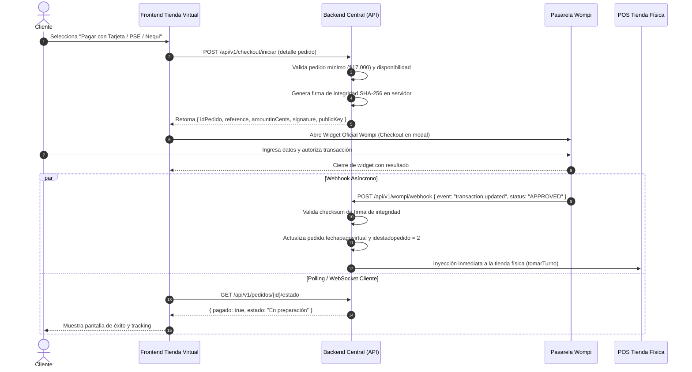

# 💳 Skill 05: Checkout, Pagos y Wompi

## 1. Diagnóstico del Flujo Actual vs. Oportunidad de Mejora

### 1.1 El Flujo Actual en Gloria Food `[Capturas y Código]`
1. El cliente selecciona en Gloria Food la opción `"Transferencia Bancaria"`.
2. Gloria Food muestra un aviso en texto: *"Pago con WOMPI, a través de un link de pago que será enviado por correo y WhatsApp, una vez pagues será enviado a elaboración tu producto"* `[Capturas]`.
3. El webhook de Kuno llega al central (`/InsertarPedidoTiendaVirtualKuno`).
4. El servidor detecta la forma de pago `4` y genera un link de Wompi mediante API REST (`PedidoCtrl.verificarEnvioLinkPagosParametrico`), registrándolo en `pedido_pago_virtual` y enviándolo por WhatsApp (Ultramsg) y correo (Brevo) `[Verificado]`.
5. El pedido queda retenido (`enviadopixel = 2`) esperando a que el cliente abra el enlace externo y pague.

> [!CAUTION]
> **Riesgo de Seguridad Encontrado en el Sistema Actual:**
> En la pantalla de consulta de pedidos (`consultapedidosnuevatienda.js`), para la función "Recrear Link Wompi", se descargaba la **llave privada de Wompi directamente al navegador del asesor**.
> **Regla de oro para la tienda nueva:** Las llaves privadas (`prv_...`) y el secreto de integridad (`integrity_secret`) deben residir **exclusivamente en variables de entorno seguras del backend**. El frontend solo debe conocer la llave pública (`pub_...`).

---

## 2. Los Métodos de Pago Activos `[Capturas y BD]`

| Método | ID en BD (`forma_pago`) | Mapeo Kuno | Regla Operativa |
|---|---|---|---|
| **Efectivo a Domicilio** | **`1`** | `CASH`, `cod`, `Efectivo` | El cliente paga al motorizado al recibir. El pedido entra a cocina sin esperar pasarela. |
| **Datáfono a Domicilio** | **`2`** | `datafono` | El domiciliario lleva datáfono físico. Entra a cocina de inmediato. |
| **Pago en Línea Wompi** | **`4` / `5`** | `Transferencia Bancaria`, `wompi` | Tarjeta de crédito/débito, PSE, Nequi, Botón Bancolombia. **Requiere confirmación previa de pago**. |
| **PayU / ePayCo** | **`6`** | `ONLINE`, `epayco` | Utilizado como excepción en 2 o 3 tiendas franquiciadas `[Confirmado por usuario]`. |

---

## 3. Arquitectura Recomendada: Checkout Embebido (Widget Wompi)

Para la tienda nueva, se sustituye el envío diferido de links por un **Checkout directo en la misma web**:

---

## 4. Firma de Integridad y Webhook de Confirmación (`/ObtenerRespuestaWompi`)

Para garantizar que nadie altere el monto ni el estado de la transacción:

### 4.1 Cálculo de la Firma de Integridad (Servidor):
$$\text{Firma} = \text{SHA256}(\text{referencia} + \text{montoEnCentavos} + \text{"COP"} + \text{integritySecret})$$

### 4.2 Procesamiento del Webhook de Respuesta:
Cuando Wompi emite el webhook a `/ObtenerRespuestaWompi`:
1. Registra el payload en `log_evento_wompi`.
2. Verifica que `event == "transaction.updated"`.
3. Si `data.transaction.status == "APPROVED"`:
   * Identifica el `idPedido` a través del campo `reference`.
   * Ejecuta `PedidoDAO.actualizarFechaPagoVirtual(idPedido)`.
   * Cambia `enviadopixel = 0` para habilitar el despacho hacia el POS de la tienda.
   * Envía confirmación por WhatsApp y correo al cliente con el recibo de compra.
