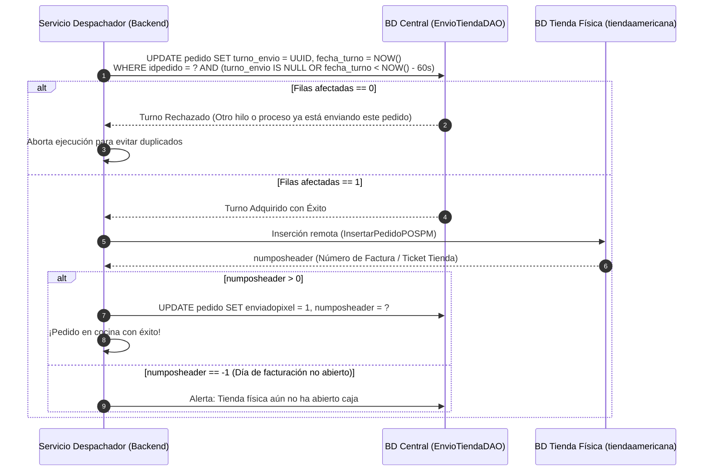

# 🖨️ Skill 06: Integración y Envío a Tienda (POS)

## 1. Topología de Red y Conectividad Central - Tiendas

Las 11 tiendas físicas operan en una red privada (LAN / VPN) alcanzable directamente desde los servidores centrales `[Verificado en red local]`:

| ID Tienda | Nombre | Host / IP (`tienda.hosbd`) | Puerto | Base de Datos POS |
|---|---|---|---|---|
| **1** | Manrique | `172.19.1.80` | 3306 | `tiendaamericana` |
| **2** | Bello | `192.168.2.20` | 3306 | `tiendaamericana` |
| **3** | América | `192.168.3.38` | 3306 | `tiendaamericana` |
| **4** | Calasanz | `192.168.4.10` | 3306 | `tiendaamericana` |
| **5** | Itagüí | `192.168.5.3` | 3306 | `tiendaamericana` |
| **7** | La Mota | `192.168.7.19` | 3306 | `tiendaamericana` |
| **8** | Envigado | `192.168.8.29` | 3306 | `tiendaamericana` |
| **9** | Pilarica | `192.168.9.39` | 3306 | `tiendaamericana` |
| **10** | San Antonio | `192.168.10.49` | 3306 | `tiendaamericana` |
| **11** | Manrique Piloto | `172.19.11.69` | 3306 | `tiendaamericana` |
| **13** | Niquía | `172.19.12.19` | 3306 | `tiendaamericana` |

> [!IMPORTANT]
> **Cambio de Paradigma:** En el sistema anterior, el envío al POS dependía de que el navegador del asesor web hiciera una petición AJAX a la IP local de la tienda. Si la pestaña se cerraba o el navegador perdía ruta, el pedido no llegaba.
> **Para la nueva tienda virtual:** El despacho debe ser ejecutado **exclusivamente por el backend central** mediante `ConexionBaseDatos.obtenerConexionBDTiendaRemota(hosbd)` con un timeout estricto de conexión (10 segundos).

---

## 2. Protocolo de Turnos Atómicos Anti-Duplicados (`tomarTurno`)

Para evitar incidentes de pedidos facturados dos veces (como el ocurrido el 2026-09-21 en Envigado), el sistema exige la toma de un **turno transaccional condicional** en `capaDAOCC.EnvioTiendaDAO` `[Verificado]`:



---

## 3. Traducción de Ítems al Modelo de Cocina del POS (`PedidoPOSPMDAO`)

Cuando el pedido se inyecta en la base `tiendaamericana` de la tienda:

1. **Línea Maestra de Pizza (`tipo_producto = 'P'`):**
   * Se registra el ítem padre con su identificador interno (`Pizza GD`, `Pizza MD`, etc.).
2. **Mitad y Mitad:**
   * Se divide en **dos registros de detalle con cantidad `0.5`** cada uno.
   * Se inserta un producto separador intermedio con **código interno `10000`** `[Verificado en código]`.
   * Cada mitad lleva asignado su respectivo sabor (`tipo_producto = 'D'`).
3. **Adiciones (`tipo_producto = 'A'`):**
   * Se ligan a la línea de detalle padre a la que pertenecen.
4. **Modificadores "CON" y "SIN":**
   * Se insertan en las tablas hijas de la tienda (`detalle_pedido_modificador`), de modo que la comanda de la cocina imprima con claridad:
     * `*** CON TOCINETA ***`
     * `*** SIN CEBOLLA ***`

---

## 4. Matriz de Resiliencia y Contingencias

```mermaid
graph TD
    Envio["Intento de Envío a Tienda Remota"] --> CheckPing{"¿Conexión TCP 3306 Exitosa?"}
    
    CheckPing -->|Sí| Inyecta{"¿Inyección en BD Exitosa?"}
    CheckPing -->|No (Timeout 10s)| ColaOffline["1. TIENDA DESCONECTADA<br/>Entra en cola de reintentos automáticos (Servicios).<br/>Alerta roja en pantalla de monitoreo."]
    
    Inyecta -->|numposheader > 0| Exito["2. ENVÍO COMPLETADO<br/>Factura generada, comanda impresa en cocina."]
    Inyecta -->|numposheader == -1| AlertaCaja["3. CAJA CERRADA EN TIENDA<br/>Tienda abierta pero no han abierto turno en POS.<br/>Notificación telefónica al administrador."]
    Inyecta -->|Error SQL / Bloqueo| Reintento["4. ERROR TRANSACCIONAL<br/>Rollback local, turno liberado al minuto."]
```

### 4.1 Reintentos Automáticos:
El daemon `ReportePedidosPendientesVirtual.java` en `Servicios` escanea cada 2 minutos pedidos con `enviadopixel = 0` y `idestadopedido = 2`. Si una tienda sufrió una micro-desconexión de internet y se restablece, el daemon inyecta de forma desatendida las órdenes pendientes tan pronto el puerto 3306 vuelve a responder.
