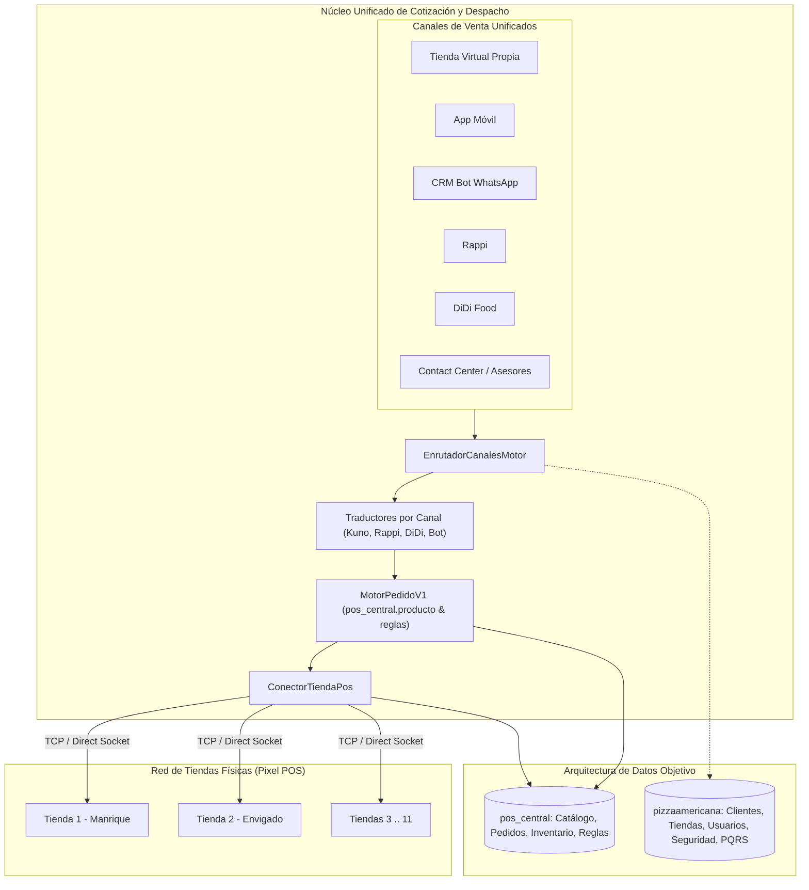
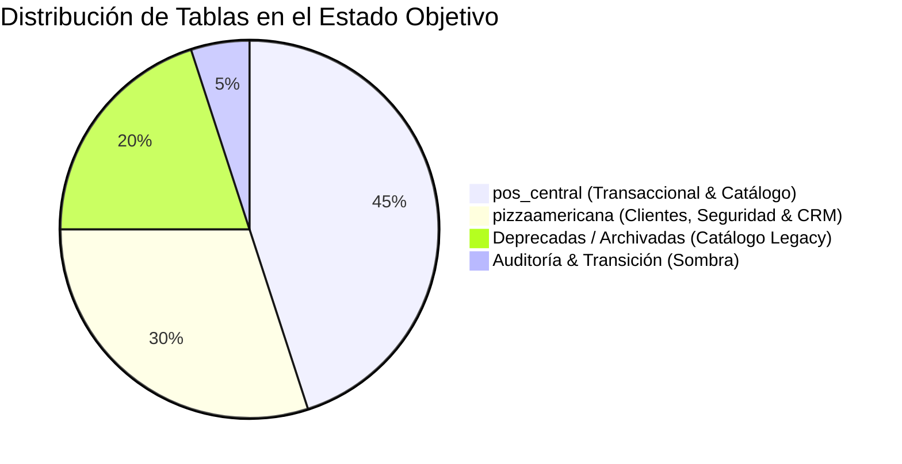

# 🚀 Plan Maestro: Transición Definitiva al Nuevo Motor, Rediseño del Sistema y Desconexión del Modelo Legacy

---

## 1. Visión General y Diagnóstico Arquitectónico

### 1.1. Contexto Histórico
Durante más de una década, **Pizza Americana** ha operado con un esquema de base de datos relacional central (`pizzaamericana`) que creció de forma orgánica y monolítica. Para soportar el ecosistema de ventas, se crearon abstracciones paralelas:
* **Catálogo fragmentado:** Una pizza no era solo un producto, sino una combinación de registros en `producto`, `especialidad`, `tamano_producto` y `excepcion_precio`.
* **Dispersión multicanal:** Cada canal externo (Gloria Food / Kuno, App móvil, CRM Bot de WhatsApp, Rappi, DiDi) requirió tablas de homologación individuales (`homologacion_producto_rappi`, `homologacion_producto_pedidovirtual`, etc.), acumulando más de **14.000 líneas de código procedural** en `PedidoCtrl.java`.
* **Doble modelo POS vs. Central:** Las tiendas físicas operan con el estándar de la industria (Pixel POS / esquema `pos_central`), mientras el contact center operaba con el modelo legacy, forzando un puente de traducción bidireccional permanente.

### 1.2. Estado Objetivo (Target State)
El objetivo final es transformar `ProyectoPizzaAmericana` en un backend moderno, limpio, modular y desacoplado, donde:
1. **`pos_central` es la ÚNICA fuente de verdad transaccional:** Catálogo, precios por lista, preguntas forzadas (mitades/opciones), inventario, pedidos y estados.
2. **`pizzaamericana` se especializa en Dominio Corporativo y CRM:** Clientes, geolocalización, seguridad RBAC, PQRS, biometría y fidelización.
3. **El Motor de Pedidos (`MotorPedidoV1`) es la única puerta de entrada:** Todos los canales (web, app, bot, agregadores, contact center) entregan un contrato estándar (`MotorSolicitud`) y el motor liquida con reglas centralizadas.
4. **Despacho directo y transaccional:** `ConectorTiendaPos` inserta directamente en la tienda vía TCP/JDBC con confirmación en milisegundos, erradicando los antiguos daemons batch y sockets inestables.



---

## 2. Matriz Definitiva de Tablas: `pizzaamericana` vs. `pos_central`

Para realizar una desconexión segura sin pérdida de datos ni traumatismos en ventas, las tablas del ecosistema se clasifican en 4 grupos estratégicos:



### 2.1. Tablas que MIGRAN o cuya Fuente de Verdad es `pos_central`

Estas tablas administran la operación de ventas, el catálogo del POS y el inventario.

| Tabla en `pos_central` | Rol y Responsabilidad | Estado y Acción |
| :--- | :--- | :--- |
| `producto` | Maestro de productos (pizzas por tamaño, bebidas, combos, salsas, etc.) | **Activa**. Reemplaza `pizzaamericana.producto`. |
| `pregunta` | Preguntas forzadas asociadas a un producto (ej. Sabor 1, Sabor 2, Bebida) | **Activa**. Gestiona la navegación de la toma de pedidos. |
| `eleccion_forzada` | Opciones disponibles por cada pregunta y columna de precio aplicable | **Activa**. Resuelve especialidades y acompañantes. |
| `producto_incluido` | Recetas y productos derivados automáticos (cajas, salsas base) | **Activa**. Sustituye la tabla homónima legacy. |
| `producto_horario` | Restricciones de disponibilidad por día de la semana y franja horaria | **Activa**. Centraliza la disponibilidad de productos. |
| `producto_horario_canal` | Sobrescritura de disponibilidad por canal (ej. sólo para BOT o Web) | **Activa**. Regula ofertas exclusivas por canal. |
| `descuentos_generales` | Reglas de descuentos diarios (% o valor fijo) y cupones | **Activa**. Reemplaza la lógica dispersa en `PedidoCtrl`. |
| `pedido` | Encabezado de la transacción central y por tienda | **Activa**. Contiene `idtienda`, `idcliente`, totales e impuestos. |
| `detalle_pedido` | Líneas maestras e hijas (jerarquía Pizza -> Mitad 1, Mitad 2, Adiciones) | **Activa**. Registra el árbol real del pedido. |
| `pedido_forma_pago` | Desglose de medios de pago por transacción | **Activa**. |
| `pedido_descuento` | Descuentos aplicados y subsidios de plataformas | **Activa**. Claridad entre descuento propio y de agregador. |
| `cambios_estado_pedido` | Trazabilidad del ciclo de vida (Ingresado, En Horno, Despachado, etc.) | **Activa**. Bitácora para analítica de tiempos. |
| `item_inventario` | Insumos y materias primas | **Activa**. Control de stock en tiendas. |
| `item_inventario_x_producto` | Receta de descarga de inventario por producto vendido | **Activa**. Descargue automático por venta. |

### 2.2. Tablas que PERMANECEN en `pizzaamericana`

Estas tablas contienen información corporativa que **no pertenece al POS de tienda**, sino a la gestión global de la empresa, fidelización, recursos humanos y seguridad.

| Tabla en `pizzaamericana` | Dominio de Negocio | Justificación de Permanencia |
| :--- | :--- | :--- |
| `cliente` | CRM y Clientes | Maestro de más de 1.000.000 de clientes, teléfonos y notas. |
| `direccion_cliente` | Logística / Geocodificación | Direcciones georreferenciadas con latitud, longitud y barrio. |
| `cliente_autorizacion_datos` | Legal / Habeas Data | Consentimientos de política de tratamiento de datos personales. |
| `tienda` | Infraestructura | Directorio de tiendas, razón social, IPs, URLs y teléfonos. |
| `tienda_servidor` | DevOps / Conexiones | Parámetros de conexión JDBC a los servidores locales de tienda. |
| `cobertura_tienda` | Logística de Despacho | Polígonos y asignación de zonas de cobertura a cada punto de venta. |
| `usuario`, `rol`, `sesion` | Seguridad Corporativa | Autenticación y control de acceso RBAC. |
| `pantalla`, `rol_pantalla` | Frontend Dinámico | Estructura de módulos y pantallas dinámicas (`MenuLegacy.html`). |
| `solicitud_pqrs` | Servicio al Cliente | Sistema de tickets, reclamaciones y seguimiento de PQRS. |
| `bono_recompra` | Mercadeo / Fidelización | Emisión, redención y vigencia de bonos de compensación. |
| `biometria_*` | Recursos Humanos | Registros de huellas, asistencias y novedades de empleados. |
| `general.parametros` | Configuración Global | Variables maestras del sistema y switches de motor. |
| `general.empleado` | Nómina | Datos maestros de colaboradores, cargos y tiendas asignadas. |

### 2.3. Tablas Legacy que se DEPRECAN y se ARCHIVAN

Tablas que quedarán en desuso una vez el nuevo motor esté encendido al 100%:

* `pizzaamericana.producto` *(reemplazada por `pos_central.producto`)*
* `pizzaamericana.especialidad` *(reemplazada por opciones en `pos_central.eleccion_forzada`)*
* `pizzaamericana.tamano_producto` *(en el nuevo modelo, cada tamaño es un producto POS independiente)*
* `pizzaamericana.excepcion_precio` *(reemplazada por `descuentos_generales` y productos de promoción)*
* `pizzaamericana.homologacion_producto_pedidovirtual` *(reemplazada por traductor nativo)*
* `pizzaamericana.homologacion_producto_rappi` *(reemplazada por `TraductorRappi`)*
* `pizzaamericana.sabor_x_tipo_liquido` *(reemplazada por `pos_central.producto` categoría bebidas)*
* `pizzaamericana.producto_incluido` *(reemplazada por `pos_central.producto_incluido`)*
* `pizzaamericana.homologacion_tienda_token` *(reemplazada por campo directo en `pizzaamericana.tienda`)*

### 2.4. Tablas de Transición y Auditoría Sombra

Tablas puente creadas para garantizar una migración sin riesgos:

* `pos_central.sombra_pedido_canal`: Almacena la comparación en paralelo para Kuno, App, Rappi y DiDi.
* `pos_central.sombra_vivo`: Almacena la comparación en sombra del CRM BOT.
* `pos_central.equivalencia_producto`: Diccionario de mapeo entre IDs centrales viejos e IDs nativos de `pos_central`.

---

## 3. Rediseño de Funcionalidades en `ProyectoPizzaAmericana`

### 3.1. Rediseño de la Pantalla de Toma de Pedidos (Contact Center)
* **Situación actual:** La interfaz de toma de pedidos para asesores telefónicos tiene listas desplegables estáticas basadas en los IDs de `pizzaamericana.producto` y `pizzaamericana.especialidad`. Si una pizza permite mitades o adiciones, el código calcula precios en el frontend mediante scripts JavaScript frágiles.
* **Rediseño propuesto:**
  1. **Árbol dinámico guiado por preguntas:** Al seleccionar un producto principal (ej. *Pizza Mediana Tradicional*), el frontend consulta la API `/ConsultarPreguntasProducto?idproducto=496`.
  2. La pantalla renderiza dinámicamente los paneles:
     * **Pregunta 1:** ¿Desea 1 o 2 sabores? (Si elige 2 sabores, habilita Mitad 1 al 50% y Mitad 2 al 50%).
     * **Pregunta 2:** Selección de especialidad (las opciones se cargan de `pos_central.eleccion_forzada`).
     * **Pregunta 3:** Selección de bebida o acompañamiento incluido.
     * **Pregunta 4:** Adiciones o modificaciones CON / SIN ingredientes.
  3. **Cotización en Vivo:** Cada cambio en la UI llama a `MotorPedidoV1.cotizar(solicitud)` vía AJAX. El backend devuelve el subtotal exacto, los impuestos desglosados y los descuentos automáticos aplicables al cliente.
  4. **Cero lógica financiera en el cliente:** El navegador solo muestra lo que el motor aprueba, eliminando discrepancias entre lo que ve el asesor y lo que factura la tienda.

### 3.2. Refactorización y Modularización de `PedidoCtrl.java`
* **Situación actual:** La clase `PedidoCtrl.java` supera las 14.100 líneas de código, centralizando validación de clientes, cálculos de descuentos, llamadas a Wompi, inserción en BD, integración con Pixel y parseo de JSONs.
* **Rediseño propuesto:** Descomponer `PedidoCtrl` en servicios especializados de responsabilidad única:
  * `ClienteService`: Creación, normalización de direcciones y geocodificación de clientes.
  * `CanalWebhookService`: Recepción limpia de webhooks (Rappi, DiDi, Kuno, Bot).
  * `MotorOrquestadorService`: Envío de `MotorSolicitud` y procesamiento de `MotorResultado`.
  * `DespachoTiendaService`: Despacho transaccional mediante `ConectorTiendaPos`.
  * `PagoService`: Homologación de formas de pago y verificación de transacciones en pasarelas.

### 3.3. Despacho e Integración con Tiendas Físicas
* **Situación actual:** Se inserta el pedido con `enviadopixel = 'N'` en `pizzaamericana.pedido`. Daemons en segundo plano (`Servicios`) realizan polling continuo consultando la BD central y conectándose por drivers obsoletos (Sybase AnyWhere / SQL Server) a los servidores de cada tienda.
* **Rediseño propuesto:**
  1. `ConectorTiendaPos` ejecuta el despacho en el mismo hilo de confirmación del pedido (o mediante cola asíncrona dedicada `BlockingQueue`).
  2. Conexión directa y atómica a la base de datos de la tienda (`tiendaamericana`).
  3. Inserción directa en las tablas locales (`pos_order`, `pos_order_item`) con los códigos del POS.
  4. Retorno inmediato del número de comanda física (`numposheader`) y confirmación hacia el cliente/canal en menos de 1 segundo.

---

## 4. Estrategia y Rediseño de Reportes y Analítica

El mayor desafío al desconectar un modelo legacy es evitar la rotura de reportes gerenciales, liquidaciones y cierres contables. Para esto se implementará el **Patrón Adaptador de Base de Datos** mediante **Vistas de Compatibilidad**.

### 4.1. Vistas SQL de Compatibilidad (The Database Adapter Pattern)

En lugar de reescribir simultáneamente los más de 40 DAOs de reportes en Java, crearemos vistas SQL en el esquema `pizzaamericana` que simulan la estructura vieja pero leen en vivo desde `pos_central`:

```sql
-- Vista que emula pizzaamericana.pedido leyendo desde pos_central.pedido
CREATE OR REPLACE VIEW pizzaamericana.v_pedido_compatibilidad AS
SELECT 
    pos.idpedidocontact AS idpedido,
    pos.idtienda,
    pos.idcliente,
    pos.fechapedido,
    pos.total_bruto,
    IFNULL(pdesc.valordescuento, 0.00) AS descuento,
    pos.total_neto,
    pos.idestado AS idestadopedido,
    pos.usuariopedido,
    pos.tiempopedido,
    pos.programado,
    pos.hora_programado,
    pos.idtipopedido,
    IFNULL(pos.numposheader, 0) AS numposheader,
    'S' AS enviadopixel
FROM pos_central.pedido pos
LEFT JOIN pos_central.pedido_descuento pdesc ON pdesc.idpedidotienda = pos.idpedidotienda;

-- Vista que emula pizzaamericana.detalle_pedido
CREATE OR REPLACE VIEW pizzaamericana.v_detalle_pedido_compatibilidad AS
SELECT 
    det.iddetalle_pedido AS iddetalle_pedido,
    pos.idpedidocontact AS idpedido,
    det.idproducto,
    det.cantidad,
    det.valorunitario,
    det.valortotal,
    0 AS idespecialidad,
    0 AS idespecialidad2,
    det.iddetalle_pedido_master
FROM pos_central.detalle_pedido det
JOIN pos_central.pedido pos ON pos.idpedidotienda = det.idpedidotienda;
```

**Ventajas de esta estrategia:**
* Los reportes existentes en `capaDAOCC` pueden seguir funcionando apuntando a `v_pedido_compatibilidad` sin cambiar su lógica interna.
* La migración de cada reporte a código Java nativo de `pos_central` se puede hacer uno por uno, con calma y verificación de cifras.

### 4.2. Matriz de Migración de Reportes Críticos

| Reporte / DAO | Métricas Principales | Estrategia de Migración |
| :--- | :--- | :--- |
| `ConsultaPedidosNuevoMotorDAO` | Ventas totales, ventas por canal, KPIs de sombra, tiempos | **Ya nativo en `pos_central`**. Es la pantalla principal de monitoreo. |
| `VentaIntegralTiendaDAO` | Ventas brutas, netas, descuentos, domicilios por punto de venta | Redirigir queries hacia `pos_central.pedido` y `pedido_forma_pago`. |
| `ReporteEnrutamientoDAO` | Desempeño y tiempos de entrega de la flota de domiciliarios | Leer de `pos_central.cambios_estado_pedido` y `despacho_real_det`. |
| `DesempenoDomiciliarioDAO` | Liquidación de turnos, entregas realizadas, propinas | Integrar con `pos_central.pedido` campo `idtipopedido = 1`. |
| `AuditoriaFidelizacionDAO` | Puntos acumulados, redenciones y retención de clientes | Cruzar `pizzaamericana.cliente` con `pos_central.pedido`. |
| `PromocionReporteCatalogoDAO` | Efectividad de promociones, 2x1 y cupones | Leer de `pos_central.pedido_descuento` y `descuentos_generales`. |

---

## 5. Hoja de Ruta Maestra de Transición: 26 Pasos Concretos

La desconexión del modelo legacy se llevará a cabo en **5 fases ordenadas**, minimizando el riesgo operativo y permitiendo el rollback en cualquier etapa.

```mermaid
flowchart TD
    subgraph F1 ["Fase 1: Coexistencia y Auditoría Sombra"]
        P1["1. Canales en Paralelo"] --> P2["2. Validación Pantalla Consulta"]
        P2 --> P3["3. Auditoría Diaria de Discrepancias"]
        P3 --> P4["4. Calibración de Traductores (99.5% Éxito)"]
        P4 --> P5["5. Piloto Exclusivo Tienda 11 (Manrique)"]
    end

    subgraph F2 ["Fase 2: Vistas de Compatibilidad y Desacople de Lecturas"]
        P5 --> P6["6. Creación Vistas SQL Compatibilidad"]
        P6 --> P7["7. Pruebas de Carga y Rendimiento en Vistas"]
        P7 --> P8["8. Clasificación de Reportes (Lectura vs Escritura)"]
        P8 --> P9["9. Redirección Lote 1: Reportes de Ventas"]
        P9 --> P10["10. Conciliación Contable y Cierres de Caja"]
    end

    subgraph F3 ["Fase 3: Rediseño Toma de Pedidos Contact Center"]
        P10 --> P11["11. Creación API REST Catálogo Dinámico"]
        P11 --> P12["12. Maquetación Nueva UI Contact Center"]
        P12 --> P13["13. Lógica Frontend Árbol de Preguntas"]
        P13 --> P14["14. Piloto con 3 Asesores Seleccionados"]
        P14 --> P15["15. Despliegue General Contact Center"]
    end

    subgraph F4 ["Fase 4: Expansión de Despacho Directo a Tiendas"]
        P15 --> P16["16. Auditoría de Conectividad en 11 Tiendas"]
        P16 --> P17["17. Despacho Directo Tiendas 2 y 3 (Envigado/Poblado)"]
        P17 --> P18["18. Despacho Directo Tiendas Restantes (4 a 11)"]
        P18 --> P19["19. Apagado de Daemons Batch Legacy"]
        P19 --> P20["20. Certificación de Tiempos < 1s"]
    end

    subgraph F5 ["Fase 5: Apagado Definitivo del Legacy y Archivo"]
        P20 --> P21["21. Reescritura Nativa de DAOs en pos_central"]
        P21 --> P22["22. Migración Pipeline Facturación Electrónica"]
        P22 --> P23["23. Migración Pipeline CRM Kommo y Datamart"]
        P23 --> P24["24. Switch Global: MODO_MOTOR_GLOBAL = 'NUEVO'"]
        P24 --> P25["25. Desactivación ProyectorPedidoLegacy"]
        P25 --> P26["26. Respaldo Final y Congelación de Tablas Legacy"]
    end
```



### Detalle de los 26 Pasos de Ejecución

#### FASE 1: Coexistencia y Auditoría Sombra *(Fase Actual)*
* **Paso 1:** Conectar los 5 canales de entrada (Kuno, App, Bot, Rappi, DiDi) en modo `PARALELO` en base de datos y código Java. *(Completado)*.
* **Paso 2:** Desplegar y validar la pantalla de consulta unificada (`ConsultaPedidosNuevoMotor.html`) con KPIs consolidados en tiempo real. *(Completado)*.
* **Paso 3:** Monitorear diariamente la tabla `pos_central.sombra_pedido_canal` extrayendo reportes de concordancia entre totales del modelo viejo vs. modelo nuevo.
* **Paso 4:** Calibrar los traductores (`TraductorKuno`, `TraductorRappi`, `TraductorDidi`, `TraductorBot`) afinando reglas de combinaciones y bebidas hasta lograr más del 99.5% de coincidencia exacta.
* **Paso 5:** Activar el modo `NUEVO` de forma exclusiva en la tienda piloto (Tienda 11 - Manrique), validando que los pedidos entren directamente por el motor y se proyecten al legacy sin incidentes.

#### FASE 2: Vistas de Compatibilidad y Desacople de Lecturas
* **Paso 6:** Diseñar y ejecutar en base de datos las vistas `v_pedido_compatibilidad` y `v_detalle_pedido_compatibilidad` en el esquema `pizzaamericana`.
* **Paso 7:** Realizar pruebas de rendimiento y estrés sobre las vistas con consultas complejas de rangos mensuales.
* **Paso 8:** Clasificar los 42 DAOs del paquete `capaDAOCC` identificando cuáles son de solo lectura y cuáles realizan escrituras complementarias.
* **Paso 9:** Modificar el primer bloque de DAOs de consulta gerencial (`VentaIntegralTiendaDAO`, `ConsultaPedidosDAO`) para que lean de las vistas de compatibilidad.
* **Paso 10:** Ejecutar conciliación contable de cierre de mes comparando las cifras arrojadas por los reportes legacy vs. las vistas de compatibilidad.

#### FASE 3: Rediseño de la Toma de Pedidos de Contact Center
* **Paso 11:** Desarrollar en Java los endpoints REST `/api/motor/catalogo` y `/api/motor/cotizar` que expongan los productos, preguntas forzadas y precios directamente desde `pos_central`.
* **Paso 12:** Construir la nueva interfaz gráfica web de toma de pedidos para asesores de Contact Center (diseño responsive, optimizado para teclado rápido).
* **Paso 13:** Implementar en el frontend la navegación guiada por preguntas forzadas (soporte nativo para 1/2 y 1/2, cambio de salsas, adiciones y combos).
* **Paso 14:** Iniciar piloto de toma de pedidos con un grupo de 3 asesores de Contact Center en horario valle, monitoreando tiempos de toma y satisfacción.
* **Paso 15:** Capacitar al 100% de los asesores y habilitar la nueva pantalla como la interfaz predeterminada en `MenuLegacy.html`.

#### FASE 4: Expansión del Despacho Directo a Todas las Tiendas
* **Paso 16:** Realizar auditoría técnica de red y conectividad JDBC en los servidores locales de las 11 tiendas físicas.
* **Paso 17:** Habilitar el despacho directo vía `ConectorTiendaPos` en Tiendas 2 y 3 (Envigado y Poblado).
* **Paso 18:** Habilitar progresivamente el despacho directo en las tiendas 4 a 11 (una tienda cada 48 horas).
* **Paso 19:** Desactivar los antiguos hilos batch de envío a Pixel (`ControladorEnvioPedidoTiendaBatch`) una vez todas las tiendas estén en despacho directo.
* **Paso 20:** Monitorear y certificar que el tiempo transcurrido desde la confirmación del cliente hasta la impresión en la cocina sea inferior a 1.5 segundos.

#### FASE 5: Apagado Definitivo del Legacy y Archivo
* **Paso 21:** Reescribir de forma nativa los DAOs analíticos clave (`ReporteEnrutamientoDAO`, `DesempenoDomiciliarioDAO`) leyendo directamente las tablas de `pos_central`.
* **Paso 22:** Adaptar el servicio de generación de Facturación Electrónica (DIAN) para que consuma los ítems, bases e impuestos de `pos_central.detalle_pedido_impuesto`.
* **Paso 23:** Ajustar la sincronización de leads hacia Kommo CRM y el pipeline de alimentación del Datamart histórico.
* **Paso 24:** Modificar el parámetro global en base de datos:
  `UPDATE general.parametros SET valortexto = 'NUEVO' WHERE valorparametro = 'MODO_MOTOR_GLOBAL';`
* **Paso 25:** Desactivar la lógica de `ProyectorPedidoLegacy` en el código Java, dejando de escribir en `pizzaamericana.detalle_pedido` y liberando un 40% de carga de I/O en la base de datos.
* **Paso 26:** Generar un dump de respaldo completo de las tablas de catálogo viejas (`pizzaamericana.producto`, `especialidad`, etc.), renombrarlas con prefijo `historico_legacy_` y dejarlas en modo solo lectura para auditoría.

---

## 6. Matriz de Riesgos y Plan de Contingencia (Rollback)

| Riesgo Operativo | Probabilidad | Impacto | Estrategia de Mitigación y Contingencia |
| :--- | :---: | :---: | :--- |
| **Discrepancia en precios durante el cambio** | Media | Alto | El motor sombra en paralelo (`sombra_pedido_canal`) detecta cualquier variación de centavos antes de apagar el legacy. |
| **Pérdida de conectividad con una tienda física** | Media | Alto | `ConectorTiendaPos` cuenta con reintentos exponenciales y cola local en memoria; si la tienda no responde, reenvía alerta inmediata al Contact Center. |
| **Descuadre en reportes contables o nómina** | Baja | Crítico | Las vistas de compatibilidad SQL garantizan que los reportes de ventas y comisiones lean los mismos pedidos con idéntica estructura. |
| **Fallo inesperado en una tienda tras activar el modo `NUEVO`** | Baja | Medio | **Rollback instantáneo en 3 segundos:** Basta con cambiar el parámetro en BD sin reiniciar el servidor: `UPDATE general.parametros SET valortexto = 'PARALELO' WHERE valorparametro = 'MODO_MOTOR_GLOBAL';` |

---

## 7. Conclusión y Recomendación de Siguiente Paso

Este plan transforma una migración riesgosa de "golpe único" (*Big Bang*) en una **evolución controlada por etapas**:
1. Hoy los canales están asegurados en **Modo Paralelo** auditando silenciosamente sin riesgo en producción.
2. Al final de la jornada de hoy podremos extraer el primer informe comparativo desde `ConsultaPedidosNuevoMotor.html`.
3. Con este documento formalizado como base de conocimiento, el equipo y la gerencia tienen una hoja de ruta clara de 26 pasos para proceder con total certeza y tranquilidad hacia la modernización completa de Pizza Americana.
